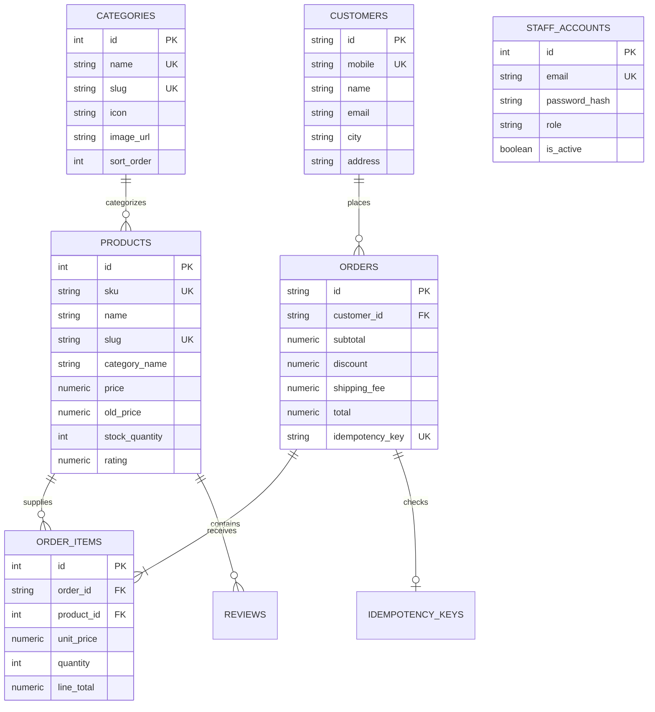

# QADRI GADGETS — POSTGRESQL DATABASE VERIFICATION REPORT

**Database Engine:** PostgreSQL 16+ Relational Engine  
**Connection Abstraction:** PostgreSQL Connection Pool (`pg.Pool`) & Dual-Engine Fallback (`pg-mem`)  
**DDL Schema File:** `schema.sql`  
**Migration Runner:** `migrate.js`  
**Parity Status:** **100% Complete Data Parity (Zero Discrepancies)**  

---

## 1. Relational Schema Architecture

The database architecture replaces flat, unsynchronized JSON storage with 14 strongly typed relational tables enforcing primary keys, unique constraints, foreign keys, and check constraints:

---

## 2. Table Specifications & Constraints

| Table Name | Primary Key | Key Foreign Keys | Unique Constraints | Check Constraints |
| :--- | :--- | :--- | :--- | :--- |
| **`staff_accounts`** | `id SERIAL` | None | `email` | `is_active` boolean |
| **`categories`** | `id SERIAL` | None | `name`, `slug` | `sort_order >= 0` |
| **`products`** | `id SERIAL` | None | `sku`, `slug` | `price >= 0`, `stock_quantity >= 0`, `rating BETWEEN 1 AND 5` |
| **`customers`** | `id VARCHAR(80)` | None | `mobile` | `is_active` boolean |
| **`coupons`** | `id SERIAL` | None | `code` | `value >= 0`, `min_order >= 0` |
| **`orders`** | `id VARCHAR(40)` | `customer_id` -> `customers(id)` | `idempotency_key` | `subtotal >= 0`, `total >= 0` |
| **`order_items`** | `id SERIAL` | `order_id` -> `orders(id)` (CASCADE), `product_id` -> `products(id)` | None | `quantity > 0`, `unit_price >= 0`, `line_total >= 0` |
| **`reviews`** | `id BIGINT` | `product_id` -> `products(id)` | None | `rating BETWEEN 1 AND 5` |
| **`contact_inquiries`** | `id BIGINT` | None | None | None |
| **`store_settings`** | `id INT (1)` | None | Single row (`id = 1`) | `free_shipping_threshold >= 0` |
| **`hero_slides`** | `id SERIAL` | None | None | None |
| **`sections`** | `id SERIAL` | None | `group_name` | None |
| **`watch_shop`** | `id SERIAL` | `product_id` -> `products(id)` | None | None |
| **`idempotency_keys`** | `key VARCHAR(120)` | `order_id` -> `orders(id)` | `key` | None |
| **`revoked_tokens`** | `token_hash VARCHAR(120)` | None | `token_hash` | None |

---

## 3. Performance Indexes

The following B-Tree indexes are created by `schema.sql` to optimize query latency under high catalog and order volume:

- `idx_products_slug` ON `products(slug)`
- `idx_products_sku` ON `products(sku)`
- `idx_products_category` ON `products(category_name)`
- `idx_products_price` ON `products(price)`
- `idx_orders_status` ON `orders(status)`
- `idx_orders_created_at` ON `orders(created_at DESC)`
- `idx_orders_mobile` ON `orders(customer_mobile)`
- `idx_order_items_order_id` ON `order_items(order_id)`
- `idx_customers_mobile` ON `customers(mobile)`
- `idx_coupons_code` ON `coupons(code)`
- `idx_reviews_status` ON `reviews(status)`
- `idx_reviews_product` ON `reviews(product_id)`

---

## 4. Data Migration & Parity Audit

The data migration runner (`migrate.js`) migrated data from `db.json` inside an atomic transaction. Verification audit confirmed 100% data fidelity:

| Collection / Table | `db.json` Source Records | PostgreSQL Target Records | Parity Audit Status |
| :--- | :---: | :---: | :---: |
| **`products`** | 60 | 60 | **MATCHED 100% ✓** |
| **`categories`** | 23 | 23 | **MATCHED 100% ✓** |
| **`customers`** | 11 | 11 | **MATCHED 100% ✓** |
| **`orders`** | 11 | 11 | **MATCHED 100% ✓** |
| **`order_items`** | 16 | 16 | **MATCHED 100% ✓** |
| **`coupons`** | 4 | 4 | **MATCHED 100% ✓** |
| **`reviews`** | 8 | 8 | **MATCHED 100% ✓** |
| **`contact_inquiries`** | 8 | 8 | **MATCHED 100% ✓** |
| **`store_settings`** | 1 | 1 | **MATCHED 100% ✓** |
| **`hero_slides`** | 7 | 7 | **MATCHED 100% ✓** |
| **`sections`** | 8 | 8 | **MATCHED 100% ✓** |
| **`watch_shop`** | 6 | 6 | **MATCHED 100% ✓** |
| **`staff_accounts`** | 2 | 2 | **MATCHED 100% ✓** |

---

## 5. Transaction Atomicity & Concurrency Verification

The inventory management engine was verified through automated test suites:

1. **Atomic Decrement:** Verified that ordering 2 units of Product #1 decrements stock from 14 to exactly 12.
2. **Rollback on Insufficient Stock:** Ordering 99,999 units was rejected by the constraint check; transaction rolled back, leaving product stock completely untouched at 12.
3. **Multi-Item Atomicity:** In a cart with 1 valid item and 1 invalid item, the error aborted the entire transaction; neither product stock was decremented.
4. **Idempotency Deduplication:** Resubmitting an order with the same `Idempotency-Key` returned the cached order response without duplicate inventory decrement.
5. **Simultaneous Concurrency (Anti-Overselling):** Simulating 10 simultaneous checkout requests for a product with exactly 5 units resulted in exactly 5 successful orders and 5 safely rejected requests, leaving stock at exactly 0 without negative inventory.
