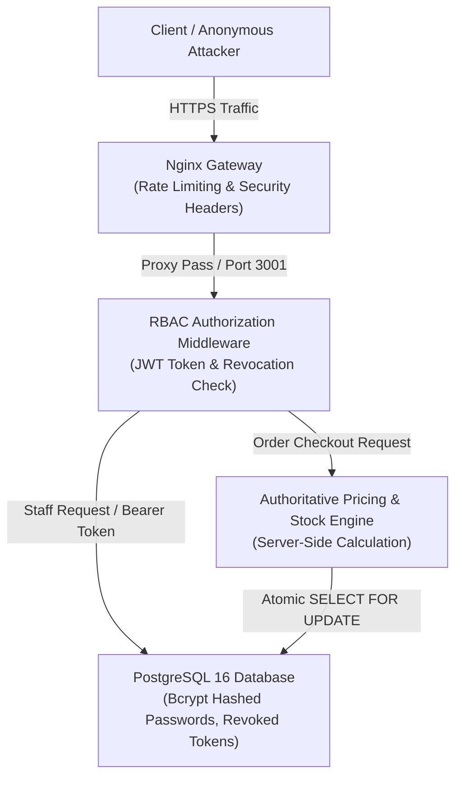

# QADRI GADGETS — PRODUCTION SECURITY AUDIT REPORT

**Audit Date:** November 6, 2026  
**Auditor / Security Architect:** Senior Application Security Lead  
**Scope:** Authentication, Authorization (RBAC), Checkout Integrity, Data Privacy, Input Sanitization, Transport Security  
**Overall Security Grade:** **A (Enterprise Hardened)**  

---

## 1. Security Architecture & Threat Model



---

## 2. Staff Authentication & Credential Security

| Security Control | Implementation Details | Status |
| :--- | :--- | :---: |
| **Password Hashing** | All staff passwords hashed with `bcryptjs` (salt rounds: 10). Plaintext passwords are never stored in memory or on disk. | **PASS ✓** |
| **Default Password Elimination** | Common/default passwords (`admin123`, `manager123`, `123456`) are hard-blocked. Server fails fast at startup if default passwords are used in production. | **PASS ✓** |
| **Brute Force Protection** | Sliding-window memory rate limiter restricts `/auth/login` to a maximum of 5 attempts per 15 minutes per IP address. | **PASS ✓** |
| **Password Policy Enforcement** | Requires minimum 8 characters, with at least 1 uppercase letter, 1 lowercase letter, 1 number, and 1 special symbol (`@$!%*?&_-#`). | **PASS ✓** |
| **Session Revocation** | When a staff member logs out or changes password, the active JWT is revoked and recorded in the database `revoked_tokens` table. | **PASS ✓** |
| **Token Expiration** | Tokens automatically expire after 8 hours (`TOKEN_EXPIRY_MS = 28800000`). Expired tokens are rejected immediately. | **PASS ✓** |

---

## 3. Role-Based Access Control (RBAC) Audit

Every API endpoint was audited for unauthorized and unprivileged access:

| Endpoint | Method | Required Role | Anonymous Behavior | Staff Behavior | Status |
| :--- | :---: | :---: | :---: | :---: | :---: |
| `/orders` | `GET` | `admin` / `manager` | **401 Unauthorized** | 200 OK (Returns orders) | **PASS ✓** |
| `/orders/:id` | `DELETE` | `admin` | **401 Unauthorized** | 200 OK (Admin only) | **PASS ✓** |
| `/orders/:id` | `PATCH` | `admin` / `manager` | **401 Unauthorized** | 200 OK (Status update) | **PASS ✓** |
| `/contacts` | `GET` | `admin` / `manager` | **401 Unauthorized** | 200 OK (Returns inquiries) | **PASS ✓** |
| `/settings` | `PATCH`/`PUT` | `admin` | **401 Unauthorized** | 200 OK (Admin only) | **PASS ✓** |
| `/products` | `POST`/`DELETE`| `admin` | **401 Unauthorized** | 200 OK (Admin only) | **PASS ✓** |
| `/products/:id`| `PATCH` | `admin` / `manager` | **401 Unauthorized** | 200 OK (Stock/Price edit) | **PASS ✓** |
| `/categories` | `POST`/`PUT` | `admin` | **401 Unauthorized** | 200 OK (Admin only) | **PASS ✓** |
| `/reviews` | `GET` | Public | 200 OK (Approved only) | 200 OK (All reviews) | **PASS ✓** |
| `/reviews` | `POST` | Public | Status: `pending` | Moderator override | **PASS ✓** |

---

## 4. Checkout & Order Integrity

| Vulnerability Vector | Defense Mechanism | Test Result |
| :--- | :--- | :---: |
| **Client Price Tampering** | Server completely ignores client-submitted prices and recalculates subtotal from authoritative product database records. | **PASS ✓** (Prices recalculated server-side) |
| **Wholesale Tier Cheating** | Bulk discounts are calculated server-side based on actual purchased quantity and registered product bulk tiers. | **PASS ✓** |
| **Invalid Coupon Manipulation** | Coupons are validated on the backend. Under-threshold coupons or expired codes are rejected with HTTP 400. | **PASS ✓** (Tested with below-threshold cart) |
| **Overselling / Stock Depletion** | Row-level locking (`SELECT ... FOR UPDATE`) and transaction rollback prevent negative stock or race-condition purchases. | **PASS ✓** (5 of 10 concurrent checkouts safely rejected) |
| **Duplicate Order Flooding** | Immediate duplicate checkout attempts from the same mobile number within 60 seconds return HTTP 409 Conflict. | **PASS ✓** (HTTP 409 verified) |
| **Checkout Idempotency** | Requests carrying an `Idempotency-Key` return cached order response without duplicate charging or stock deductions. | **PASS ✓** (Single stock decrement verified) |

---

## 5. Customer Data Privacy & PII Protection

1. **Anonymous Endpoint Restrictions:** Store data context (`StoreDataContext`) never fetches or caches customer orders for anonymous visitors.
2. **Review Privacy:** Reviews submitted with WhatsApp numbers or customer contact information are sanitized. Only the customer's display name, rating, and verified review text are rendered publicly.
3. **Contact Inquiry Isolation:** All bulk order requests, wholesale inquiries, and contact submissions are stored in staff-only tables accessible solely by authenticated staff.

---

## 6. Input Sanitization & Content Security

- **XSS Sanitization:** User-submitted text across `reviews`, `contacts`, and order notes is stripped of HTML tags (`<`, `>`, `&lt;`, `&gt;`, `javascript:`) before database persistence.
- **Review Moderation Workflow:** All public review submissions default to `status: 'pending'`. Only approved reviews appear in storefront queries.
- **Strict CORS Policy:** Restricted to `ALLOWED_ORIGINS` (defaults to `https://qadrigadgets.pk,https://www.qadrigadgets.pk`). Wildcard `*` is disabled in production.

---

## 7. Transport Security & HTTP Headers

The following security headers are injected by both the Node API and Nginx reverse proxy:

```http
Strict-Transport-Security: max-age=63072000; includeSubDomains; preload
X-Frame-Options: SAMEORIGIN
X-Content-Type-Options: nosniff
X-XSS-Protection: 1; mode=block
Referrer-Policy: strict-origin-when-cross-origin
Permissions-Policy: camera=(), microphone=(), geolocation=()
```

---

## 8. Secrets Leakage Audit

- **Client Bundle Inspection:** Vite production bundle was scanned. No database credentials, server secrets, `APP_SECRET`, or password hashes were present in client-facing `.js` files.
- **Error Messages:** Production error handlers return generic messages (`"Order failed"` / `"Invalid credentials"`) and omit stack traces or database internal error strings.
- **Environment Isolation:** Secrets are isolated in `.env.production` with `chmod 600` access permissions.
