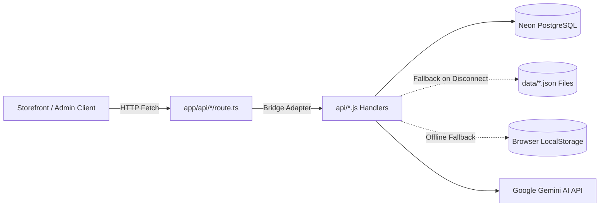
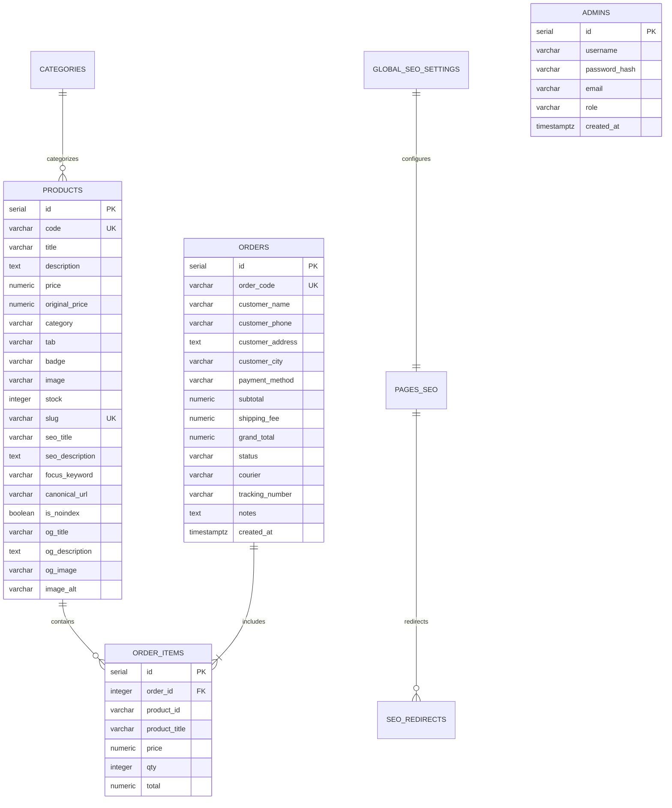
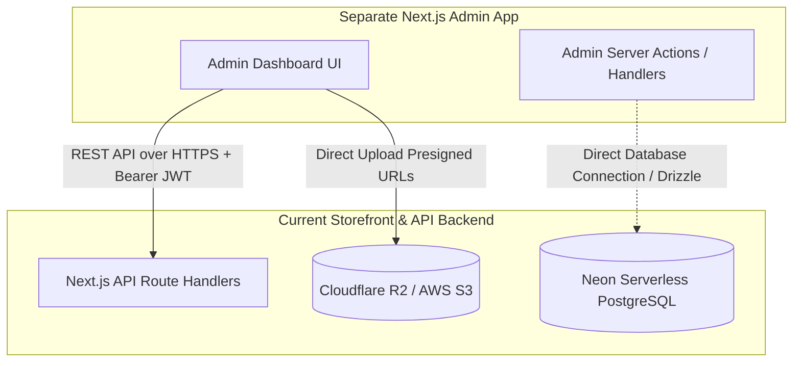
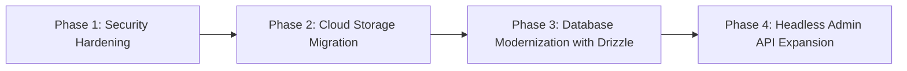

# Technical Architecture & System Audit Report: Save & Smile E-Commerce
**Document ID:** ARCH-REV-2026-10-14  
**Project:** Save & Smile Wholesale E-Commerce Platform  
**Target Codebase:** `C:\Users\IT MART\.gemini\antigravity\scratch\My-Store`  
**Classification:** Technical Analysis & Architectural Blueprint  
**Author:** Senior Next.js Software Architect  
**Status:** Complete  

---

## Executive Summary

The **Save & Smile** e-commerce codebase is an active, production-oriented wholesale shopping platform built on **Next.js 14 (App Router)** and **React 18** with a **TypeScript** frontend and a dual-layer **Node.js/Serverless** API backend. The system features a multi-tiered resilience data strategy combining **Neon Serverless PostgreSQL**, server-side JSON persistence, and browser `localStorage`.

This report provides an exhaustive, code-grounded architectural analysis of the frontend, backend, database, security, deployment, e-commerce features, and headless admin panel integration pathways. Every observation is cross-referenced with exact files and code structures in the repository.

---

## 1. Frontend Architecture

### 1.1 Router & Rendering Model
* **Router Paradigm:** **Next.js App Router** (`app/` directory).
* **Next.js Version:** `14.2.35` (specified in `package.json`).
* **React Version:** `18.3.1` (`react` and `react-dom`).
* **Language & Compiler:** **TypeScript 5.4.5** for all storefront components, pages, and type definitions; supported by Next.js type checking.
* **Styling Framework:**
  * **Tailwind CSS 3.4.17** with PostCSS and Autoprefixer (`tailwind.config.js`, `postcss.config.js`).
  * Legacy and customized utility CSS in `css/style.css`.
  * Iconography powered by `lucide-react` (v0.344.0).
  * Smooth animations powered by `framer-motion` (v11.0.8).

### 1.2 Storefront & Administrative Page Inventory

| Route | Source File | Rendering Mode | Purpose & State |
| :--- | :--- | :--- | :--- |
| `/` | `app/page.tsx` | Client-Side (`'use client'`) | Primary storefront, dynamic hero carousel, wholesale banner grid, category tabs, catalog listing, and quick-add modals. |
| `/product-detail` | `app/product-detail/page.tsx` | Client-Side (`'use client'`) | Single product view via search query (`?id=...` or `?code=...`), image gallery, quantity selector, variant picker, and direct checkout initiation. |
| `/cart` | `app/cart/page.tsx` | Client-Side (`'use client'`) | Full-page shopping cart with item quantity modifiers, subtotal recalculations, and delivery threshold indicators. |
| *(Drawer Cart)* | `components/CartDrawer.tsx` | Client Component | Slide-over drawer cart integrated globally in the header navigation for frictionless checkout. |
| `/checkout` | `app/checkout/page.tsx` | Client-Side (`'use client'`) | One-page Guest Checkout. Collects customer contact, shipping address, city, and Cash on Delivery (COD) confirmation. |
| `/track-order` | `app/track-order/page.tsx` | Client-Side (`'use client'`) | Public order status lookup via Order ID or Phone number. Fetches timeline from `/api/orders?track=...`. |
| `/admin` | `app/admin/page.tsx` | Client-Side (`'use client'`) | Integrated administrative dashboard with tabs for Catalog management, Order fulfillment, and SEO optimization. |
| `/admin/builder` | `app/admin/builder/page.tsx` | Client-Side (`'use client'`) | Visual storefront layout and hero banner builder with real-time JSON preview and publishing. |
| `/live-editor` | `app/live-editor/page.tsx` | Client-Side (`'use client'`) | In-context visual customization tool for store banners and typography. |
| `/login` | **DOES NOT EXIST** | N/A | **Missing:** No dedicated customer login route exists. Admin authentication is modal/embedded in `/admin`. |
| `/register` | **DOES NOT EXIST** | N/A | **Missing:** Customer registration is not implemented; transactions are guest-only. |
| `/account` | **DOES NOT EXIST** | N/A | **Missing:** No customer profile, saved addresses, or past order history dashboard. |

### 1.3 Folder Structure Breakdown

```
My-Store/
├── .git/                      # Git version control metadata (branch main)
├── .next/                     # Next.js build cache and compilation outputs
├── api/                       # Core Node.js API handlers (Express/Serverless style)
│   ├── auth.js                # JWT issuance, verification, and admin credentials
│   ├── chat.js                # AI Chatbot Assistant (Google Gemini SDK)
│   ├── db.js                  # Neon Serverless PostgreSQL connection manager
│   ├── health.js              # System & database health probe
│   ├── home-customization.js  # Storefront hero & section customization API
│   ├── orders.js              # Order checkout, lookup, tracking, and status updates
│   ├── products.js            # Product CRUD, validation, and SEO attribute synchronization
│   └── seo.js                 # Dynamic sitemaps, robots.txt, 301/302 redirects, audit
├── app/                       # Next.js 14 App Router Directory
│   ├── admin/                 # Admin dashboard and visual layout builder
│   │   ├── builder/page.tsx
│   │   └── page.tsx
│   ├── api/                   # Next.js Route Handlers (REST entry points bridging to api/*.js)
│   │   ├── auth/route.ts
│   │   ├── chat/route.ts
│   │   ├── health/route.ts
│   │   ├── home-customization/route.ts
│   │   ├── orders/route.ts
│   │   ├── products/route.ts
│   │   ├── seo/route.ts
│   │   └── upload/route.ts
│   ├── cart/page.tsx          # Full shopping cart page
│   ├── checkout/page.tsx      # Single-page guest checkout
│   ├── live-editor/page.tsx   # Live storefront customization UI
│   ├── product-detail/page.tsx# Dynamic product detail view
│   ├── track-order/page.tsx   # Order tracking portal
│   ├── layout.tsx             # Root HTML layout, font injection, and global providers
│   ├── page.tsx               # Storefront homepage component
│   ├── providers.tsx          # Client-side context providers
│   └── globals.css            # Base Tailwind and layout styling
├── components/                # Modular React UI Components
│   ├── admin/                 # Admin view submodules (OrdersView, ProductsView, SeoView)
│   ├── builder/               # Drag-and-drop / form builders for storefront sections
│   ├── CartDrawer.tsx         # Slide-over cart drawer
│   ├── Footer.tsx             # Global storefront footer with store policy links
│   ├── Header.tsx             # Main navigation, category menu, search, cart counter
│   ├── HeroSlider.tsx         # Dynamic hero banner carousel
│   ├── ProductCard.tsx        # Product display card with pricing and quick-buy
│   ├── ProductDetailModal.tsx # Quick-view product modal
│   └── QuickCheckoutModal.tsx # Fast checkout overlay modal
├── css/                       # Additional stylesheet assets (`style.css`)
├── data/                      # Local JSON persistence store (fallback layer)
│   ├── home_customization.json
│   ├── orders.json
│   ├── seo_pages.json
│   ├── seo_redirects.json
│   └── seo_settings.json
├── lib/                       # Shared utility libraries and TypeScript definitions
│   ├── db.ts                  # TypeScript database helper
│   ├── store.ts               # Local storage caching, price recalculation, fallback data
│   ├── types.ts               # Core domain interfaces (Product, CartItem, Order, SEO)
│   └── utils.ts               # String formatters, currency helpers, and class mergers
├── public/                    # Static public assets (images, logos, icons, uploads)
│   ├── images/
│   ├── uploads/               # Processed WebP uploaded media files
│   ├── favicon.ico
│   └── products.json          # Bundled baseline product catalog (30 items)
├── next.config.js             # Next.js build configuration, image optimization, rewrites
├── package.json               # Project manifest, scripts, and runtime dependencies
├── schema.sql                 # PostgreSQL DDL schema definition
├── tsconfig.json              # TypeScript compilation rules
└── vercel.json                # Vercel deployment and routing rules
```

---

## 2. Backend Architecture

### 2.1 Backend Architecture Model
The backend implements a **Hybrid Dual-Layer Route Handler** architecture:
1. **Next.js Web Standard Ingress (`app/api/*/route.ts`):** Modern Next.js App Router route handlers receiving standard `Request` and `NextResponse` objects.
2. **Node.js Business Logic Layer (`api/*.js`):** Node.js CommonJS modules implementing HTTP handlers compatible with Express/Vercel serverless request/response conventions (`(req, res)`). Route handlers in `app/api/` transform Web Fetch `Request` objects into mock `req`/`res` objects, invoke the handler, and return clean `NextResponse` payloads.



### 2.2 Complete API Inventory

| HTTP Method | API Route | Handler Location | Access Control | Purpose |
| :--- | :--- | :--- | :--- | :--- |
| `GET`, `POST` | `/api/auth` | `api/auth.js` | Public (`POST` login) | Issues JWT tokens upon validating admin credentials. |
| `GET` | `/api/products` | `api/products.js` | Public | Retrieves all catalog products with fallback to `products.json`. |
| `POST`, `PUT` | `/api/products` | `api/products.js` | Admin (JWT Bearer) | Creates or updates a product record across database and JSON files. |
| `DELETE` | `/api/products` | `api/products.js` | Admin (JWT Bearer) | Deletes a product by ID from database and JSON fallbacks. |
| `GET` | `/api/orders` | `api/orders.js` | Public / Admin | Public if `?track=...` is passed; returns administrative list if unparameterized. |
| `POST` | `/api/orders` | `api/orders.js` | Public | Checkout creation. Validates prices server-side, generates order code, saves to DB & JSON. |
| `PUT`, `PATCH` | `/api/orders` | `api/orders.js` | Admin (JWT Bearer) | Updates order status (`Processing`, `Shipped`, `Delivered`, `Cancelled`) and courier tracking. |
| `GET`, `POST`, `PUT` | `/api/home-customization`| `api/home-customization.js`| Public (GET) / Admin (POST/PUT)| Retrieves or updates hero banners, promotional grids, and section metadata. |
| `GET`, `POST` | `/api/seo` | `api/seo.js` | Public / Admin | Handles `/sitemap.xml`, `/robots.txt`, 301/302 redirects, and page meta tags. |
| `POST` | `/api/upload` | `app/api/upload/route.ts` | Open / Unprotected | Receives binary image, converts to WebP via Sharp, writes to `public/uploads/`. |
| `POST` | `/api/chat` | `api/chat.js` | Public | Customer support chatbot utilizing Google Gemini (`gemini-1.5-flash`). |
| `GET` | `/api/health` | `api/health.js` | Public | System diagnostic endpoint reporting database status and latency. |

### 2.3 Entity Management & Data Strategy

* **Products:** Managed centrally via `/api/products`. On query, the server attempts to query `Neon PostgreSQL`. If the database is disconnected, missing tables, or offline, it falls back to parsing `products.json` from the file system.
* **Customers:** **No distinct customer entity exists.** Customer information (name, phone, address, city, notes) is stored strictly as embedded metadata inside each order record (`orders` table or `orders.json`).
* **Shopping Cart:** **100% Client-Side.** Cart state resides in `localStorage` under the key `qadri_cart`. When the user navigates between pages, `lib/store.ts` synchronizes the cart. Prices are recalculated authoritatively on the server during checkout in `api/orders.js`.
* **Orders:** Orders are created through `/api/orders`. The backend recalculates items against current catalog pricing, computes shipping rules (e.g., free shipping threshold at Rs 3,000), assigns an autogenerated tracking number (`LEOP-xxxxxx` / `SNS-xxxxxx`), and executes a dual-write: first to Neon SQL (`orders` & `order_items`), then appending to `data/orders.json`.
* **Persistence Evaluation:** The application uses a **Three-Tier Resilience Strategy**:
  1. **Primary Backend:** Neon Serverless PostgreSQL (real cloud SQL database).
  2. **Secondary Local Storage:** Server-side static/runtime JSON files (`data/*.json` and `products.json`).
  3. **Tertiary Client Cache:** Browser `localStorage` (`save_and_smile_server_products`, `qadri_orders`, `qadri_custom_products`).

---

## 3. Database Architecture

### 3.1 Database Engine & Connection
* **Database Provider:** **Neon Database** (Serverless PostgreSQL).
* **Connection Technology:** `@neondatabase/serverless` (v0.9.0).
* **Connection Manager:** `api/db.js` and `lib/db.ts`. Uses `neon(process.env.DATABASE_URL)` to create serverless HTTP query clients without persistent TCP pooling bottlenecks.
* **ORM/Query Builder:** **None.** The project utilizes native SQL tagged template literals (`sql\`SELECT ...\``). There is **no Prisma, Drizzle, Mongoose, or TypeORM** in the dependency tree.

### 3.2 Schema Analysis (`schema.sql`)

The database architecture is defined in `schema.sql` and consists of 8 relational tables:



#### Detailed Table Specifications:
1. **`products`:** Core catalog table. Stores pricing, stock count, categorization tabs, badge indicators (`HOT`, `NEW`, `SALE`), and full SEO/OpenGraph metadata (`slug`, `seo_title`, `focus_keyword`, `canonical_url`, `is_noindex`).
2. **`orders`:** Stores transaction headers, customer details (`customer_name`, `customer_phone`, `customer_address`, `customer_city`), financial totals (`subtotal`, `shipping_fee`, `grand_total`), fulfillment lifecycle status (`status`), and courier assignments (`courier`, `tracking_number`).
3. **`order_items`:** Line items linked via foreign key `order_id REFERENCES orders(id) ON DELETE CASCADE`. Captures `product_id`, `product_title`, item unit price, quantity, and line total.
4. **`categories`:** Category taxonomy storing name, slug, parent relationship, image banner, sort order, and metadata.
5. **`admins`:** Administrative credentials storing `username`, `password_hash`, `email`, and `role`.
6. **`pages_seo`:** Granular per-page SEO overrides (`seo_title`, `seo_description`, `canonical_url`, `og_image`).
7. **`global_seo_settings`:** Single-row configuration storing global sitewide metadata, organization schema, helpline WhatsApp numbers, Google Search Console / GA4 verification tokens, and shipping parameters (`shipping_fee`, `free_shipping_threshold`).
8. **`seo_redirects`:** Active 301/302 URL redirection manager with loop detection (`source_path`, `destination_path`, `status_code`, `hit_count`).

### 3.3 Migrations & Schema Evolution
* **Migration Tooling:** **No automated migration runner** (e.g., Prisma Migrate or Drizzle Kit) is installed.
* **Evolution Strategy:** Relies on raw SQL migration scripts (`schema.sql`) executed manually or runtime `CREATE TABLE IF NOT EXISTS` / `ALTER TABLE ... ADD COLUMN IF NOT EXISTS` blocks embedded in API initialization routines.

---

## 4. Authentication and Security

### 4.1 Authentication System
* **Auth Protocol:** **JSON Web Token (JWT)** stateless bearer tokens.
* **Libraries:** `jsonwebtoken` (v9.0.2) for token signing and verification; `bcryptjs` (v2.4.3) for password hashing and validation.
* **Token Lifetime:** Configured for 7 days (`7d`) in `api/auth.js`.
* **Token Verification:** Implemented via `verifyAuthToken(req)` in `api/auth.js`. Parses `Authorization: Bearer <token>` from HTTP headers.

### 4.2 Roles and Authorization

| Role | Permissions & Scope | Implementation |
| :--- | :--- | :--- |
| **Customer** | **Unauthenticated / Guest Only.** No customer accounts, login, or persistent profiles exist. Orders are placed as guest transactions. | Verification relies only on matching Phone/Order ID for public order tracking. |
| **Administrator** | **Full Administrative Access.** Product CRUD, order status modifications, courier tracking assignment, SEO settings, and banner builders. | Protected via `verifyAuthToken` inspecting JWT payload containing `{ username, role: 'Admin' }`. |

### 4.3 Security & Architectural Vulnerability Audit

> [!WARNING] Critical Security & Reliability Findings
> 1. **Permissive CORS Header Configuration:**
>    - All major endpoints (`api/products.js`, `api/orders.js`, `api/home-customization.js`, `api/seo.js`) set:
>      `res.setHeader('Access-Control-Allow-Origin', '*');`
>    - This allows any external web origin to trigger API requests directly. While useful during development, it should be restricted to trusted domains in production.
> 2. **Fallback Administrative Credentials in Code:**
>    - In `api/auth.js`, if environment variables `ADMIN_USERNAME` or `ADMIN_PASSWORD` are not provided, or if the database is unreachable, the system evaluates against hardcoded fallback strings. If these match default credentials, an admin JWT is issued.
> 3. **Fallback JWT Secret Key:**
>    - If `process.env.JWT_SECRET` is unset, `api/auth.js` falls back to a static internal string. This allows arbitrary token forging if the secret is omitted in production.
> 4. **Unprotected File Upload Endpoint:**
>    - `app/api/upload/route.ts` lacks authentication middleware (`verifyAuthToken`). Anyone with network access to the API can POST binary image data to the server.
> 5. **Absence of Rate Limiting:**
>    - No rate-limiting middleware (e.g., Redis Upstash or in-memory token bucket) is attached to `/api/auth`, `/api/orders`, or `/api/chat`. This exposes the store to brute-force credential stuffing, checkout spamming, and AI token budget exhaustion.

---

## 5. Deployment Architecture

### 5.1 Hosting & Infrastructure
* **Target Platform:** Configured for **Vercel** serverless hosting.
* **Routing & Clean URLs:** `vercel.json` defines clean URL rewriting and route aliasing:
  * `/track` rewrites to `/track-order`
  * `/sitemap.xml` rewrites to `/api/seo?type=sitemap`
  * `/robots.txt` rewrites to `/api/seo?type=robots`
* **Cloudflare Footprint:** The codebase includes Cloudflare configurations (`wrangler.toml`, `_headers`, `_routes.json`) suggesting the site was either previously deployed to or proxied through Cloudflare Pages/Workers.
* **Repository:** Git version-controlled under GitHub repository `iamjamalullah/saveandsmile.git` on branch `main`.

### 5.2 Environment Variable Inventory
*(Values omitted in accordance with security specifications)*

* `DATABASE_URL`: Connection string for the Neon Serverless PostgreSQL instance.
* `JWT_SECRET`: Secret key used for signing and verifying administrator authentication tokens.
* `ADMIN_USERNAME`: Master administrative account identifier.
* `ADMIN_PASSWORD`: Master administrative account password.
* `GEMINI_API_KEY`: API key for Google Gemini generative AI assistant integration.
* `NODE_ENV`: Runtime environment (`development`, `production`).
* `PORT`: Local development port specification (default: `3000`).

### 5.3 External Service Integrations
* **Neon Database:** Cloud-hosted serverless PostgreSQL for primary persistence.
* **Google Gemini AI:** Generative assistant (`gemini-1.5-flash`) powering the customer support chat widget in `api/chat.js`.
* **Leopards Courier Service:** Simulated/algorithmic tracking code generator (`LEOP-xxxxxx`) for order fulfillment tracking.
* **Sharp Image Processing:** Local Node.js binary library (`sharp` v0.35.5) converting uploaded imagery to optimized WebP format.

> [!IMPORTANT] Ephemeral File System on Serverless
> `app/api/upload/route.ts` writes uploaded images to `process.cwd()/public/uploads/`.  
> On serverless platforms such as Vercel, the local container file system is **ephemeral and read-only** outside `/tmp`. Files written to `public/uploads/` during a serverless function invocation will disappear across function lifecycles and will not persist across deployments. An external object storage provider (such as Cloudflare R2 or AWS S3) is required for persistent production media uploads.

---

## 6. E-Commerce Functionality Matrix

The following matrix evaluates the store's current technical capabilities based strictly on source code verification:

| E-Commerce Dimension | Implementation Status | Technical Details & Code Evidence |
| :--- | :---: | :--- |
| **Product CRUD** | **SUPPORTED** | Complete `GET`, `POST`, `PUT`, `DELETE` operations implemented in `api/products.js` with admin UI in `components/admin/ProductsView.tsx`. |
| **Categories & Variants** | **SUPPORTED** | Category taxonomy in `schema.sql`. Multi-variant support (color, size, variant image, SKU) defined in `lib/types.ts` (`ProductVariant`) and supported in `ProductDetailModal.tsx`. |
| **Stock & Inventory** | **SUPPORTED** | Numeric `stock` attribute tracked on products in PostgreSQL and JSON. Decrements and availability checks supported. |
| **Customer Management (CRM)**| **NOT SUPPORTED** | **Missing.** No `customers` table or customer accounts. Customer data is stored redundantly as order attributes. No customer lifetime value, order history, or profile editing. |
| **Order Management** | **SUPPORTED** | Order creation, tracking code assignment, status updates (`Processing`, `Shipped`, `Delivered`, `Cancelled`), and admin management via `components/admin/OrdersView.tsx` and `api/orders.js`. |
| **Payments & Refunds** | **PARTIAL** | **Cash on Delivery (COD)** and manual offline payment instructions are fully implemented. **No automated payment gateway** (e.g., Stripe, JazzCash, EasyPaisa) and **no automated refund API** exist. |
| **Coupons & Discounts** | **PARTIAL** | Promotional coupon codes and percentage badges are supported in the homepage banner builder (`hot_selling.coupon_code`), but **no checkout validation engine** exists to dynamically discount cart subtotals during checkout. |
| **Shipping & Delivery** | **SUPPORTED** | Flat-rate delivery fee (Rs 200) with dynamic free shipping threshold (Rs 3,000) configurable in `global_seo_settings` and verified authoritatively in `api/orders.js`. |
| **Banner & Theme Builder** | **SUPPORTED** | Comprehensive visual builder in `app/admin/builder/page.tsx` and `api/home-customization.js` for hero slides, promotional banners, and category tiles. |
| **SEO Metadata Engine** | **SUPPORTED** | Dynamic XML sitemaps (`/sitemap.xml`), `robots.txt`, 301/302 redirects, JSON-LD schema, and OpenGraph social preview tags managed via `api/seo.js`. |
| **Product Image Uploads** | **PARTIAL** | Upload API exists (`/api/upload`) with Sharp WebP optimization, but writes to local disk (`public/uploads/`), which is incompatible with stateless serverless hosting (Vercel). |

---

## 7. Headless Admin Panel Integration Architecture

If you intend to build or connect a **separate, standalone Next.js Admin Panel** (e.g., hosted on a separate domain such as `admin.saveandsmile.pk`), this section details the integration strategy, reusable components, and required extensions.

### 7.1 Integration Approaches



#### Option A: Headless REST API Integration (Recommended)
The external Admin Panel interacts with the existing site exclusively through HTTP REST requests using JWT authentication.
* **Pros:** Keeps business logic centralized in one codebase; storefront and admin share identical validation rules; zero duplicate SQL code.
* **Cons:** Requires updating CORS policies to allow the admin domain and adding authentication middleware to all mutation routes.

#### Option B: Shared Database Architecture
The external Admin Panel connects directly to the **Neon PostgreSQL database** using `@neondatabase/serverless` or an ORM like Drizzle/Prisma.
* **Pros:** Complete freedom to build complex analytics queries, background cron jobs, and batch mutations without overloading storefront API endpoints.
* **Cons:** Requires schema synchronization across two independent repositories; bypassing storefront APIs skips the `data/*.json` fallback synchronization.

---

### 7.2 Reusable Existing Assets
A new admin panel can immediately reuse the following existing endpoints and structures:

1. **Authentication:**
   - `POST /api/auth` (Action: `login`): Authenticates admin credentials and returns the 7-day JWT.
   - `POST /api/auth` (Action: `verify`): Validates token integrity.
2. **Product Catalog Management:**
   - `GET /api/products`: Full product listing with category and SEO metadata.
   - `POST /api/products`: Create new product.
   - `PUT /api/products`: Update existing product.
   - `DELETE /api/products`: Delete product by ID.
3. **Order Fulfillment:**
   - `GET /api/orders`: Administrative order listing with customer and item details.
   - `PUT / PATCH /api/orders`: Update fulfillment status, courier name, and tracking numbers.
4. **Homepage & Theme Builder:**
   - `GET /api/home-customization`: Fetch active hero slides, promo grids, and custom banners.
   - `POST / PUT /api/home-customization`: Publish homepage structural updates.
5. **SEO & Redirects:**
   - `GET /api/seo?action=redirects`: Fetch 301/302 redirect rules.
   - `POST /api/seo`: Add/update redirects, modify global SEO tags, update GA4/GSC verification codes.
6. **Domain Types:**
   - TypeScript definitions in `lib/types.ts` (`Product`, `ProductVariant`, `CartItem`, `HeroSlide`, `HomeThemeConfig`) can be copied directly into the admin project.

---

### 7.3 Missing Capabilities Required for a Standalone Admin Panel

To deliver an enterprise-grade administrative experience, the following features and backend components must be implemented:

1. **Dedicated Cloud Media Storage (S3 / Cloudflare R2):**
   - Replace local file writes in `/api/upload` with presigned upload URLs targeting Cloudflare R2 or AWS S3.
   - This ensures images uploaded via the admin panel persist permanently on CDN infrastructure.
2. **Strict Domain-Specific CORS Configuration:**
   - Replace `Access-Control-Allow-Origin: *` with an explicit whitelist:
     ```javascript
     const allowedOrigins = ['https://saveandsmile.pk', 'https://admin.saveandsmile.pk'];
     ```
3. **Customer Entity & CRM APIs:**
   - Create a dedicated `customers` table in PostgreSQL.
   - Provide `/api/customers` endpoints for listing registered customers, viewing lifetime spend, reviewing order histories, and managing blocked/flagged phone numbers.
4. **Role-Based Access Control (RBAC):**
   - The current schema only supports a single `Admin` role.
   - Introduce granular roles: `SuperAdmin` (all permissions), `StoreManager` (products, categories, banners), `FulfillmentAgent` (orders and shipping only), and `SeoSpecialist` (SEO and redirects).
5. **Dynamic Coupon & Promotion Engine:**
   - Create a `coupons` table (`code`, `discount_type`, `discount_value`, `min_spend`, `expiry_date`, `usage_limit`).
   - Implement checkout validation in `api/orders.js` so promotional codes applied in the admin panel are validated during customer checkout.
6. **Audit Logging & Activity Tracking:**
   - Implement an `audit_logs` table recording which administrator created, updated, or deleted products, changed order statuses, or modified SEO settings.
7. **Webhook Dispatching:**
   - Webhook triggers on order creation (`order.created`) to notify WhatsApp messaging services, Google Sheets, or courier fulfillment APIs (TCS, Leopards, Trax).

---

## 8. Architectural Verdict & Modernization Roadmap

### 8.1 Architectural Strengths
* **High Availability Through Fallbacks:** The three-tier data hierarchy ensures that even if the primary Neon PostgreSQL database encounters downtime or configuration errors, the store automatically falls back to local JSON and client storage, preventing storefront outages.
* **SEO-First Architecture:** The dynamic sitemap, automated robots.txt generation, OpenGraph metadata, and 301 redirect manager are built directly into the core platform, delivering strong organic search capabilities.
* **Server-Side Checkout Validation:** The checkout API validates prices against the database or authentic catalog rather than trusting client-submitted prices, preventing client-side price tampering.

### 8.2 Architectural Limitations
* **Stateless Media Persistence:** Local image writing to `public/uploads/` will fail to persist across serverless deployments on platforms like Vercel.
* **Unstructured Migrations:** Relying on manual SQL scripts without an ORM migration runner creates risks of database schema drift across environments.
* **Single Role Security Model:** Lack of granular RBAC and hardcoded fallback credentials represent significant security vulnerabilities for multi-user operations.

---

### 8.3 Recommended Step-by-Step Modernization Roadmap



1. **Phase 1: Security Hardening (Immediate)**
   * Remove all hardcoded credential fallbacks in `api/auth.js`.
   * Enforce mandatory `JWT_SECRET`, `ADMIN_USERNAME`, and `ADMIN_PASSWORD` environment variables.
   * Restrict CORS origin headers from wildcard `*` to verified domains.
   * Attach `verifyAuthToken` middleware to `app/api/upload/route.ts`.
2. **Phase 2: Cloud Storage Migration (High Priority)**
   * Set up a Cloudflare R2 bucket with a custom media domain (e.g., `cdn.saveandsmile.pk`).
   * Update `/api/upload` to upload WebP buffers directly to R2 using `@aws-sdk/client-s3`.
3. **Phase 3: Database Modernization with Drizzle ORM (Medium Priority)**
   * Adopt **Drizzle ORM** with `@neondatabase/serverless`. Drizzle provides type-safe schema definitions, zero runtime overhead, and clean automated migration generation (`drizzle-kit`) while preserving serverless HTTP query speeds.
4. **Phase 4: Headless Admin Expansion (Feature Growth)**
   * Implement Customer CRM and Coupon tables in the schema.
   * Expose paginated, filtered admin endpoints for orders, products, and customer analytics.
   * Connect your dedicated Next.js Admin Panel to these authenticated endpoints.

---
*Report generated and validated by Senior Next.js Software Architect.*  
*Artifact stored at:* `WEBSITE_ARCHITECTURE_REPORT.md`
